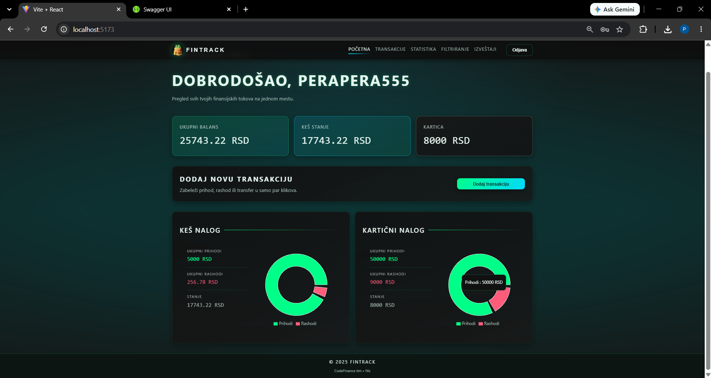
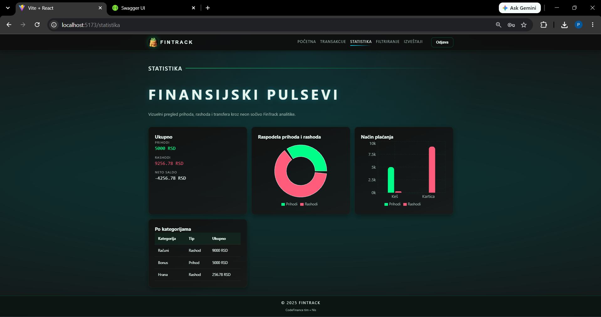
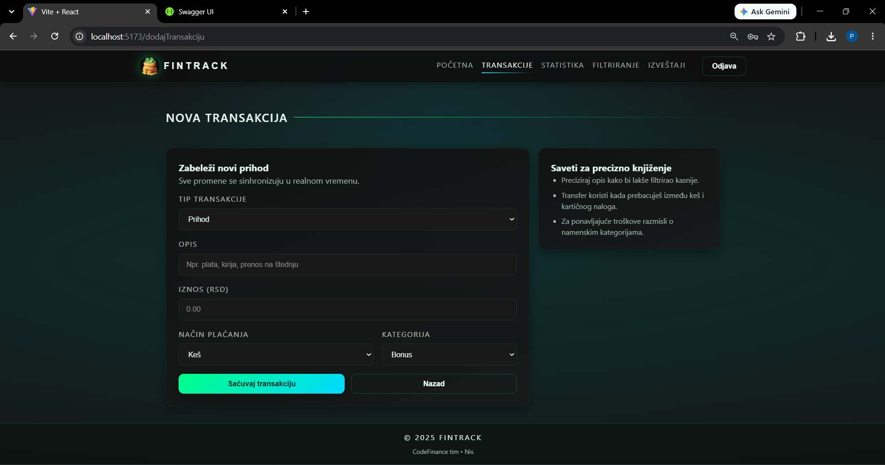
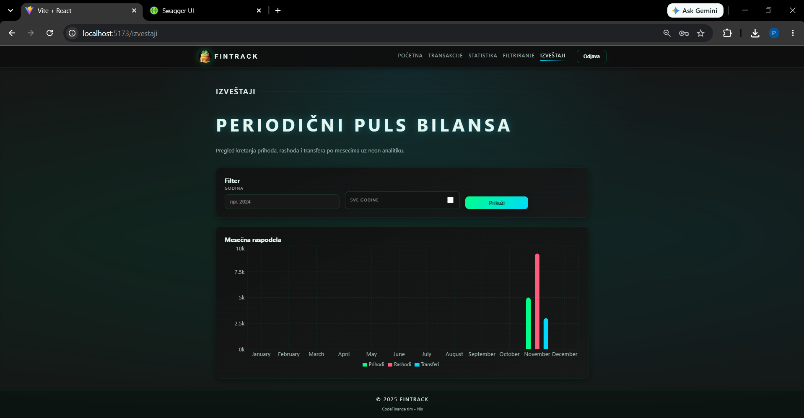
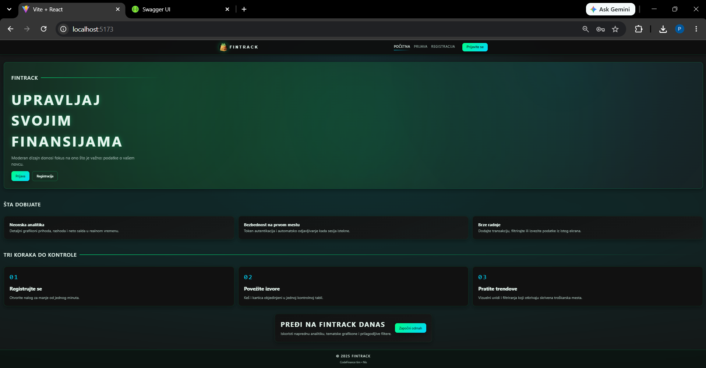
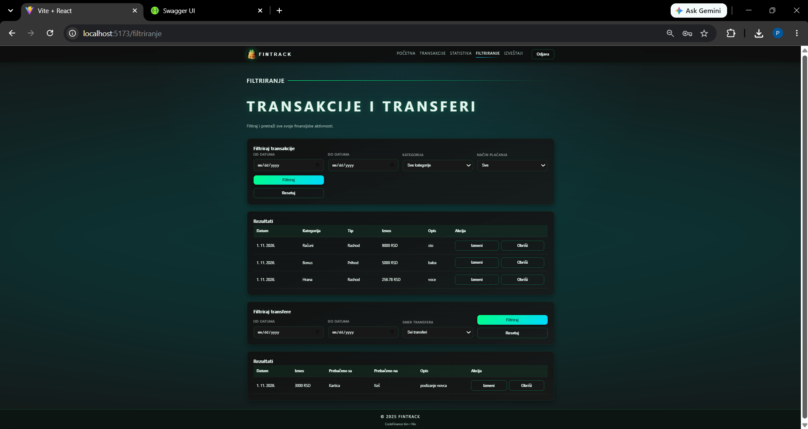
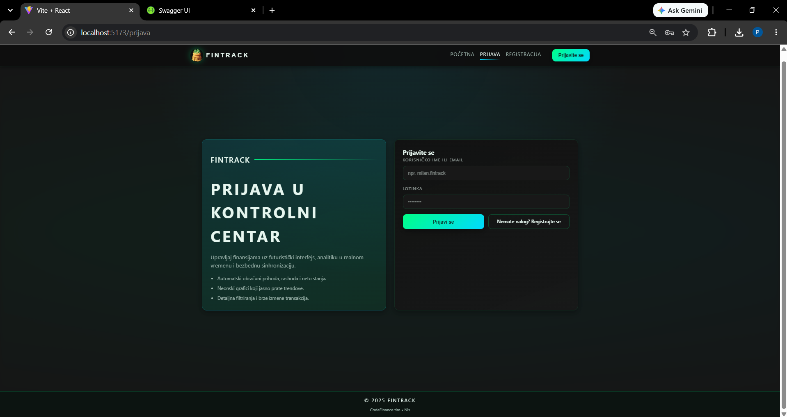
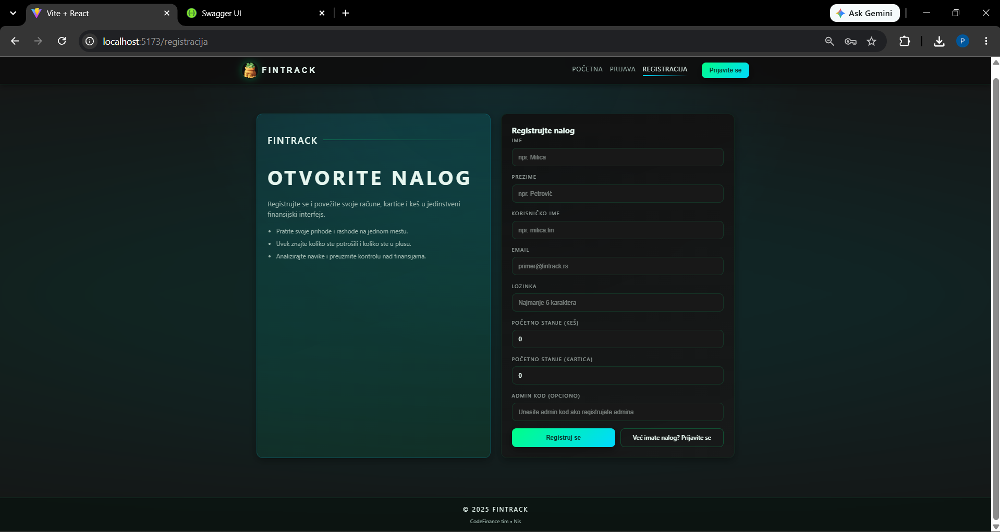
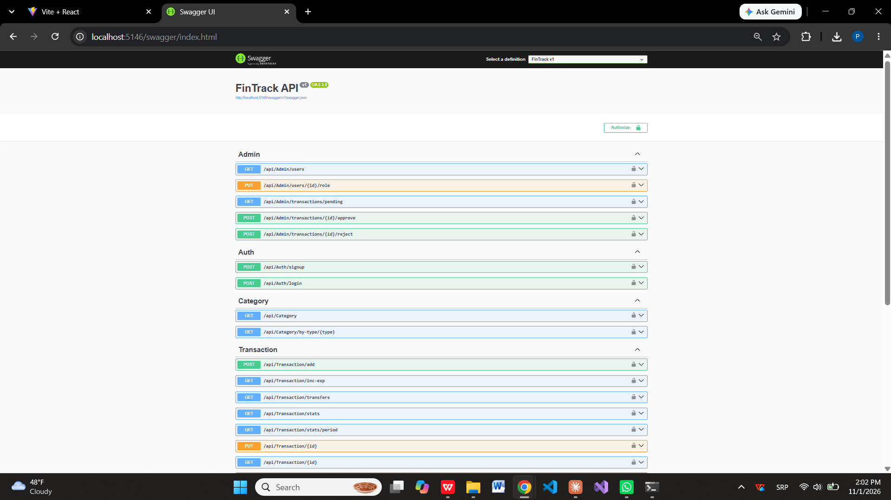
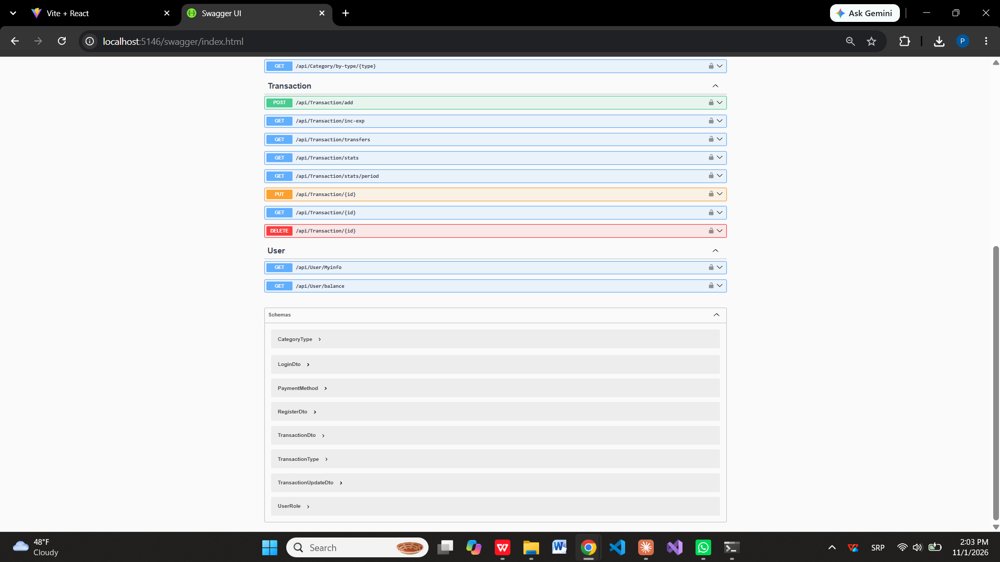

# FinTrack

A full-stack personal finance management app for tracking income, expenses and transfers, with categorized transactions, visual spending statistics and an admin review workflow.


> Team project developed for the *Software Engineering* course at the Faculty of Electronic Engineering, University of Niš.

## Screenshots

| Dashboard | Statistics |
|-----------|------------|
|  |  |

| New transaction | Reports |
|-----------------|---------|
|  |  |

<details>
<summary><b>More screenshots</b></summary>

| Home | Filtering |
|------|-----------|
|  |  |

| Sign in | Registration |
|---------|--------------|
|  |  |

</details>

### API (Swagger)




## Features

- **Authentication** – user registration and login secured with JWT, role-based authorization (User / Admin)
- **Admin panel** – manage user roles and review pending transactions (approve / reject)
- **Transactions** – record income, expenses and transfers between cash and card accounts; edit, delete, filter and search
- **Categories** – organize transactions by income and expense categories
- **Statistics & reports** – income vs. expense analysis, per-category breakdowns and monthly reports with interactive charts

## Tech Stack

| Layer | Technologies |
|-------|--------------|
| Frontend | React, Vite, JavaScript, React Router, Axios, Recharts |
| Backend | ASP.NET Core 8 Web API, Entity Framework Core, JWT Authentication, Swagger |
| Database | Microsoft SQL Server (LocalDB) |
| Tools | Visual Studio, VS Code, Git, GitHub |

## Architecture

The application follows a client–server architecture with a RESTful API:

```text
React + Vite (SPA)
        │  HTTP / JSON (JWT bearer token)
        ▼
ASP.NET Core Web API (.NET 8)
        │
        ▼
Entity Framework Core (Code First, migrations)
        │
        ▼
SQL Server
```

## API Overview

| Resource | Endpoints |
|----------|-----------|
| Auth | `POST /api/Auth/signup`, `POST /api/Auth/login` |
| Transaction | `POST /add`, `GET /inc-exp`, `GET /transfers`, `GET /stats`, `GET /stats/period`, `GET` / `PUT` / `DELETE /{id}` |
| Category | `GET /api/Category`, `GET /api/Category/by-type/{type}` |
| User | `GET /api/User/MyInfo`, `GET /api/User/balance` |
| Admin | `GET /users`, `PUT /users/{id}/role`, `GET /transactions/pending`, `POST /transactions/{id}/approve`, `POST /transactions/{id}/reject` |

All endpoints except `signup` and `login` require a JWT bearer token. Full interactive documentation is available via Swagger UI.

## Getting Started

### Prerequisites

- [.NET 8 SDK](https://dotnet.microsoft.com/download/dotnet/8.0)
- [Node.js](https://nodejs.org/) 18 or newer
- SQL Server LocalDB (installed with Visual Studio)
- EF Core CLI: `dotnet tool install --global dotnet-ef`

### 1. Clone the repository

```bash
git clone https://github.com/petarNi/fintrack.git
cd fintrack
```

### 2. Run the backend

```bash
cd Aplikacija/back/FinTrack
dotnet restore
dotnet ef database update
dotnet run
```

The API runs at `http://localhost:5146` (Swagger UI: `http://localhost:5146/swagger`).

### 3. Run the frontend

```bash
cd Aplikacija/front
npm install
npm run dev
```

The app runs at `http://localhost:5173`.

## Project Structure

```text
fintrack/
├── Aplikacija/
│   ├── back/FinTrack/     # ASP.NET Core Web API (Controllers, Models, Data, Migrations)
│   └── front/             # React + Vite client
├── Dokumentacija/         # Project documentation (in Serbian)
├── docs/screenshots/      # README images
└── README.md
```

## Documentation

Full project documentation (in Serbian) is available in [`Dokumentacija/`](Dokumentacija/) and includes the system vision, requirements specification, architecture design, test plan and user manual.

## Team

- **Petar Nikolić** – [@petarNi](https://github.com/petarNi) – backend development (ASP.NET Core Web API)
- Aleksa Nešić
- Nikola Tančić
